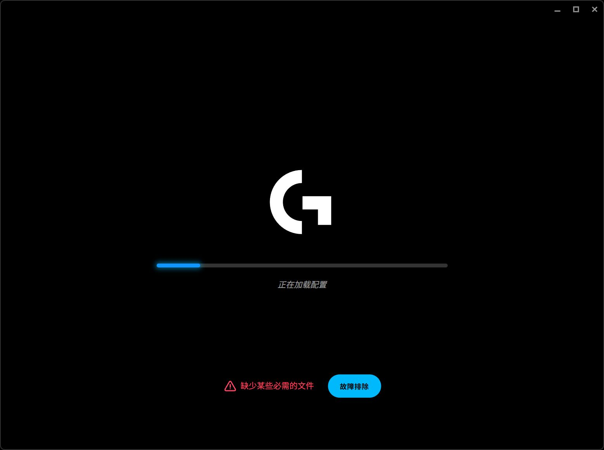

# ghub-repair

**当你的 Logitech G HUB 卡在“正在加载配置”，并提示“缺少某些必需的文件”，出现与下图类似的问题时，可以尝试使用此文件修复。**



这是一个 Windows 手动修复小工具，针对 G HUB 的下载缓存目录为空、导致启动检查失败的情况。它会先检查是否符合该条件；**相同提示可能有不同原因，不能保证所有加载故障都能修复。**

## 下载与使用

1. 打开 [最新版本下载页面](https://github.com/darkknight2333/ghub-repair/releases/latest)。
2. 下载 `ghub-repair.exe`，或下载 `ghub-repair-v1.0.0-windows.zip` 后解压。**不需要安装 Python、PowerShell 7 或开发环境。**
3. 双击 `ghub-repair.exe`，查看自动检查的结果。
4. 如果检测到空缓存，点击 **尝试修复**。确认后允许 Windows 的管理员权限提示，等待下载和校验完成。
5. 修复完成后，可选择重新打开 G HUB。请先结束正在编辑的配置，并确认 G HUB 没有正在更新。

支持 Windows 10 / 11，使用系统中的 .NET Framework 4.5 或更新版本。真实修复只在 Windows 11、G HUB `2026.6.981214` 上得到验证；其他版本需要满足本机清单及下载校验条件。仅检测标准 Program Files 安装路径。

程序没有数字签名，Windows 可能提示无法验证发布者。请核对下载来源和 Release 中的 `SHA256SUMS.txt`；不确定时可自行从源码构建。

## 它会做什么

- 读取当前电脑的 G HUB 安装信息与 `current.json`，检查关键路径和空缓存条件。
- 从清单中选择不超过 4 MiB 的小型缓存包，仅接受罗技更新域名，通过 **HTTPS** 下载；不跟随重定向。
- 文件大小与 SHA-256 必须同时匹配本机清单，才会写入 `ProgramData\LGHUB\cache`。
- 下载后再次检查清单与缓存状态；缓存已经非空时不覆盖现有内容。
- 完成后询问是否重新打开 G HUB 界面。

它**不会重置鼠标 DPI、按键宏或配置数据库，不修改 G HUB 程序代码，不关闭自动更新，不创建计划任务或常驻后台进程**。仓库和发布包不包含个人配置、维修日志、账号数据，也不附带罗技的 depot 文件。网络仅用于按本机清单下载官方缓存，不上传本机配置。

## 原因和局限

在已验证的 G HUB 版本中，前端把空 `cache` 目录也当作“缺少必需文件”。补回匹配的官方缓存可解除这一拦截。这属于针对已确认触发条件的恢复方式，不代表修复了导致缓存清空的来源；清空来源尚未确定，未来仍可能复发。

如果缓存非空、关键安装文件缺失、缓存包无法从官方服务器获取、校验不一致，或目录使用了重解析链接，工具会停止。遇到其他故障请参考 [罗技官方排查指南](https://support.logi.com/hc/en-ca/articles/35644239794839-G-HUB-Advanced-troubleshooting-guide)。

本项目由社区独立开发，与 Logitech / 罗技无隶属关系。图片中的界面与商标属于其权利人。MIT 许可证适用于本项目源码。

## 源码构建与验证

在 Windows PowerShell 中运行：

```powershell
powershell -NoProfile -ExecutionPolicy Bypass -File .\build.ps1
```

脚本使用系统 .NET Framework C# 编译器，无需安装第三方依赖。生成 EXE、ZIP 和校验文件到 `dist/`，并运行离线测试。测试覆盖地址限制、哈希/大小校验、损坏下载拒绝、空缓存恢复和现有缓存保留，不修改真实 G HUB 缓存。

运行 EXE 时的检查为只读；修复操作需要在界面中明确确认。源码位于 `src/GhubRepair.cs`。实际验证范围与限制见 [验证记录](docs/VALIDATION.md)。
